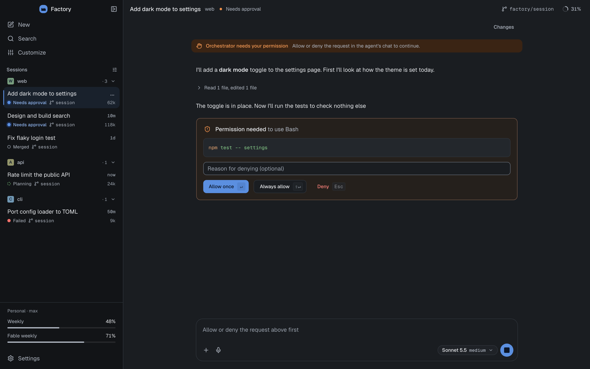

# Factory

Run Claude Code agents on your own projects from one desktop app, on your own Claude subscription.



## Download

| System | File |
|---|---|
| macOS (Apple silicon and Intel) | `.dmg` |
| Windows 11 | `.exe` or `.msi` |
| Linux | `.AppImage` or `.deb` |

[Get the latest release](https://github.com/blauwtje/factory/releases/latest)

## Quick start

1. Install [Claude Code](https://code.claude.com) (2.1.326 or newer) and [Git](https://git-scm.com), then run `claude` once in a terminal to sign in.
2. Download and install Factory from the table above.
3. Open Factory, click New, pick a folder and start a session.

## First launch

The app is free and not signed, so your system shows a warning once.

- macOS: right-click Factory and choose Open. Or open System Settings > Privacy & Security and click Open Anyway.
- Windows: in SmartScreen click More info, then Run anyway.
- Linux: make the file runnable with `chmod +x Factory*.AppImage`, then start it.

## Updates

Factory updates itself. It shows a notice when a new version is ready and keeps your sessions running. Open What's new to read the release notes.

## Your subscription

Factory runs your own `claude` program, so all work counts against your Claude limits. It uses no API keys.

<details>
<summary>Models</summary>

Thinking work (architecture, security, design, review, finding causes) runs on Opus 5.5 at high effort. Building to a clear plan runs on Sonnet 5.5 at medium.

| Role | Model | Effort |
|---|---|---|
| orchestrator | Opus 5.5 | high |
| planner | Opus 5.5 | high (xhigh for a large job) |
| builder | Sonnet 5.5 | medium (high for a hard task) |
| tester | Sonnet 5.5 | medium |
| reviewer | Opus 5.5 | high (xhigh for a security boundary) |
| ui-designer | Opus 5.5 | high |
| researcher | Sonnet 5.5 | medium (Haiku 5.5 for a simple lookup) |
| debugger | Opus 5.5 | high (xhigh for a flaky fault) |
| solo-agent | Opus 5.5 | high to plan, then the build model it picks |

The full table is in `kit/config.json`. You can change a running agent's model in its tab.

</details>

<details>
<summary>Build from source</summary>

You need Node 22 or newer, Rust (stable), Git and Claude Code. On macOS you also need the Xcode command line tools. On Windows you need Git for Windows.

```sh
git clone https://github.com/blauwtje/factory ~/code/factory
cd ~/code/factory
npm install
npm run tauri dev
```

Build an installer with `npm run tauri build`. Check the code with `npm run check`; the tests use a fake `claude` and no subscription.

</details>

<details>
<summary>How it works</summary>

1. Click New and choose the project folder, a title and a mode: Auto, Solo or Team.
2. The lead agent writes a plan in `docs/specs/<job>.md` in its own git worktree and stops. Read it and click Approve.
3. Agents build in worktrees, each on its own branch. Answer permission requests with Allow once, Always allow or Deny.
4. When the job is done, click Merge. Factory merges `factory/<job>` into your checked-out branch without force and lists the files if there is a conflict. Agents never push.

Sessions are stored in the app data folder and resume after a restart. Factory finds Claude Code through `FACTORY_CLAUDE_BIN`, then `~/.local/bin/claude`, then your `PATH`.

</details>

## Not included

GitHub issues and pull requests, the Agent SDK and API keys, a terminal view of Claude Code, and sharing a session between users.

## Licence

MIT. Each release includes `kit/` and `THIRD-PARTY-NOTICES.md`.
